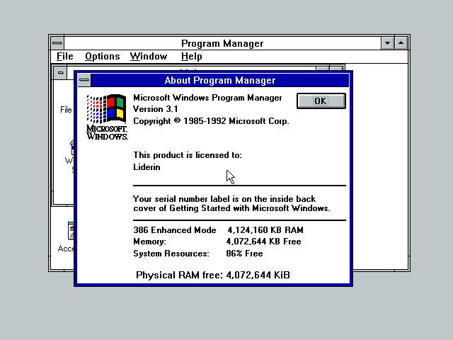

# WINRAM

WINRAM expands usable memory and selected system-resource pools on DOS and early Windows. The release has one public executable, **`bin/WINRAM.EXE`**. It identifies installed operating systems, applies the matching changes and keeps the original files for removal. It supports offline installations on other DOS drive letters.



## Install or remove

Copy `WINRAM.EXE` to a writable DOS-accessible drive. For Windows 1.x and 2.x, keep the supplied 369-byte `WINRAM.PIF` settings file beside it. If you copied only the EXE, running `WINRAM /PIF` in DOS recreates these settings. From DOS, run it without arguments to see a numbered list of installations. Select a number or enter a directory. Windows runs the same numbered interface as a DOS application. Open it from a DOS prompt or launch it from the Executive, Program Manager, File Manager or Explorer. Early versions may prompt for a Program Information File (PIF).

```dos
WINRAM /LIST
WINRAM
WINRAM D:\SYSTEMS\WIN31
WINRAM /PATH C:\WINDOWS
WINRAM /VERIFY C:\WINDOWS
WINRAM /UNINSTALL C:\WINDOWS
```

- A second selection of an installed target asks **“Already installed. Uninstall?”**. Answering **N** preserves the installation. Use `/I` or `/INSTALL` for an unattended install-only request. Use `/UNINSTALL /YES` for unattended removal.
- Scanning walks directories beneath mounted DOS drive letters. The list includes the drive and directory even when two installations are the same edition. Use the short FAT name for a long directory name. A filesystem must have a DOS-accessible drive letter. A DOS 7.1 or later maintenance disk can see FAT32 installations that MS-DOS 5 and 6 cannot mount.
- Select a DOS boot root to install its memory driver and utilities. Selecting `C:\DOS` also resolves to the corresponding boot root. For Windows, select the directory containing the installation. Apply changes to each Windows installation you use.
- At a DOS prompt the installer verifies the input binaries, stages the changes, then applies them. From early Windows, queued changes run before Windows on the next DOS boot. Windows 9x uses its native startup rename mechanism when the selected Windows directory is active. Restart the affected system to activate changes. Each installation keeps its own record. [Windows 98 SE install, verification and removal across reboots](src/verification/windows98-restart.json)
- Original files are retained under **`WRMSTATE\Bxxxx.BKP`** beneath the selected target. Shared DOS boot files use **`\WRMBOOT`** and the DOSX boot profile uses **`\WRMLOW`**. The installation record maps names to destinations. Removal restores the original contents, FAT attributes and timestamps. Existing backups survive removal. Later edits to managed files are saved as additional `.BKP` files before restoration.
- A pending file transaction resumes when the same target is selected again. Keep its state directory with the installation. The shared XMS driver is released when the last dependent installation is removed.

## Executable compatibility in v1.0.1

WINRAM resolves the active code inside the selected installation. For Windows 3.x it follows the NE exports and the KERNEL imports for menu allocation and release. Windows 95, 98 and Me use a different USER heap initialization routine. Windows 1.x and 2.x bind USER into the system binary and overlay. The installer uses the format and allocator for each family. A translated resource, a different file checksum, a relocated code segment or a vendor trailer can coexist with the patch.

Windows 3.1 kernel entry points and the 386 VMM use their own executable tables. The installer checks the affected instructions and relocation records. It can add a resident page when translated data occupies the space required by the VMM patch. If a required operation is missing or ambiguous, installation stops before replacing the system files. SHA-256 still verifies the user's exact backups, staged output and installed files.

QEMU runs used English Windows 3.0a, 3.1 and Windows for Workgroups 3.11, plus Windows 3.1 system modules and shells from Turkish and German retail disks. The localized Program Manager dialogs showed **4,124,160 KB** and **4,124,156 KB** respectively. Automatic recognition requires a compatible executable format and allocator. The tested versions and guest measurements are listed in the verification record. [Compatibility results](src/verification/dynamic-compatibility.json) · [Turkish Program Manager](src/verification/screens/w31-tr-about.png) · [German Program Manager](src/verification/screens/w31-de-about.png)

## What the numbers mean

The screenshots use **4,032 MiB** of QEMU guest RAM, or **3.9375 GiB**. BIOS and device reservations account for the difference between installed RAM and the usable amount. The displays read the running guest. The Windows 1.01 test at **256 MiB** reports **261,056 KiB** of free XMS. [256 MiB screenshot](src/verification/screens/w101-256.png)

| System and mode | Memory path | Measurement at 4,032 MiB |
| --- | --- | --- |
| Windows 1.01, 2.03 and Windows/286 2.11 | XMS 3 from Win16 | 4,127,680 KiB of XMS at the Executive |
| Windows/386 2.11 | Window into a reserved high XMS block | 4,094,912 KiB in the bank |
| Windows 3.0a Real | XMS 3 | 4,127,680 KiB at boot, 4,126,656 KiB free after Windows starts |
| Windows 3.0a Standard and 386 Enhanced | DOSX bank or enhanced-mode virtual device | 4,115,392 KiB in the bank |
| Windows 3.1 Standard | DOSX bank | 4,115,392 KiB in the bank |
| Windows 3.1 and WfW 3.11 Enhanced | Native 386 VMM and DPMI | Program Manager reported 4,124,160 KiB on Windows 3.1 and 4,124,096 KiB on WfW. A Win16 DPMI client verified 3,744 MiB with swap disabled |
| MS-DOS 5.00, 6.22, 7.10 and 8.00 | XMS 3 | 4,127,680 KiB in each guest |
| Windows 95 OSR2, 98 SE and Millennium Edition | Patched VMM, VCACHE and Win32 memory reporting | Seven concurrent Win32 processes verified 3,500 MiB on 95 and 98 SE, and 3,360 MiB on Me |

A real-mode application's **conventional** memory and the **XMS** pool have separate allocators. A conventional free reading around 400 KiB can coexist with several GiB of free XMS. The Executive shows both values. Program Manager and File Manager label the bank or XMS free count separately from their Win16 heap. Enhanced Windows 3.1 and WfW use the same DPMI physical-page count for the native KB Free field and the explicitly labelled physical RAM field. [Windows 1.01](src/verification/screens/w101-desktop.png) · [Windows 3.0 File Manager](src/verification/screens/w30-real-file.png) · [Windows 3.1 Standard](src/verification/screens/w31-standard.png) · [WfW 3.11](src/verification/screens/wfw-enhanced.png)

| About window open during a 16 MiB allocation | Before | In use | After release |
| --- | ---: | ---: | ---: |
| Windows 1.01, 2.03 and Windows/286 2.11, XMS free | 4,127,680 | 4,111,296 | 4,127,680 |
| Windows 3.0a Real, XMS free | 4,126,656 | 4,110,272 | 4,126,656 |
| Windows 3.0a Standard and Enhanced and Windows 3.1 Standard, bank free | 4,115,392 | 4,099,008 | 4,115,392 |
| Windows/386 2.11, bank free | 4,094,912 | 4,078,528 | 4,094,912 |
| Windows 3.1 Enhanced, physical RAM free | 4,072,656 | 4,056,272 | 4,072,656 |
| WfW 3.11 Enhanced, physical RAM free | 4,072,576 | 4,056,192 | 4,072,576 |

All entries in this table are KiB. Other applications and drivers change the starting value. [Allocation and release logs](src/verification/memory-cycles.json)

## Ordinary Win16 applications

On the tested Windows 1.01, 2.03, Windows/286 and Windows/386 2.11, Windows 3.0a, Windows 3.1 and WfW 3.11 installations, WINRAM extends the standard Win16 global-memory calls. An application can allocate private movable blocks with `GlobalAlloc`, write through `GlobalLock`, unlock them, and later lock the same handles to read back their contents. The application needs no WINRAM import and no recompilation. The installed memory service uses XMS, the session's bank, or DPMI according to the selected mode.

Windows retains a native working allocation while a pointer is locked. Unlocked data can move to high memory. The memory service reserves a reusable working window for large blocks so a reader can reach its data again under pressure. Moving data between that window and high memory takes time on workloads that repeatedly lock and unlock large blocks. Fixed or shared blocks, stacks, local heaps, driver buffers and objects explicitly wired in memory still follow their native allocation rules. Code that keeps a pointer after unlocking it, derives a selector directly from a handle, or needs many simultaneously locked blocks has additional compatibility constraints. Real-mode segment addressing and the number of handles or selectors available in the guest limit each application's working set.

The installer makes the service a loader dependency of Windows 3.x USER. Windows 1.x and 2.x start it through the normal Windows Executive startup list. Windows 1.01 activates the memory entries after the system has finished bootstrapping. On these early versions, programs started before the service can retain their original API bindings. To update an existing installation, run `WINRAM /UNINSTALL /YES` for its directory, then run `WINRAM /I` for the same directory.

With Windows swap disabled, one ordinary Win16 application held and verified **3,760 MiB** in both Windows 3.1 Enhanced and WfW 3.11. The Program Manager screenshot shows **4,124,160 KB RAM** and **4,072,644 KB Free** before application stress.

The test application uses only standard Win16 memory calls. It holds all allocations together, writes two distinct markers per 4 KiB page, reacquires each block by its public handle and verifies those markers before freeing the block. A separate test checks nested locks under allocation pressure, fixed and shared pointers and a growing zero-initialized allocation. [Measurements and test sources](src/verification/win16-global-memory.md)

## System resources

| Resource | Measured result |
| --- | --- |
| Windows 1.01 menus | 1,482 to 2,451 simultaneous empty menus |
| Windows 2.03, Windows/286 and Windows/386 menus | 1,457 to 2,420 |
| Windows 3.0a Real / Standard / Enhanced | 2,142 menus in each mode. Solid brushes reached 1,967 / 1,967 / 1,973 |
| Windows 3.1 and WfW 3.11 | 2,296 to 2,960 menus and 1,328 to 1,672 brushes at the same 9% resource threshold |
| Windows 95 OSR2, 98 SE and Me | Each shared 32-bit USER and GDI heap grows from 2 MiB to 32 MiB. The test created and released 6,500 menus containing 208,000 items |
| MS-DOS 5, 6, 7 and 8 | `FILES=255`. One process opened and closed 250 additional file handles |

Resource percentages still follow the guest's allocation rules. Driver-specific tables, the conventional address space, 16-bit handles, selectors and per-task address limits retain their architectural bounds. Win16 programs can also request high storage through the documented bank transfer interface. Native enhanced-mode allocation is available on patched Windows 3.1 and WfW. Original 286 hardware and 24-bit-address-bus 386SX systems have a 16 MiB physical address ceiling. [Bank interface](src/modules/BANK.md)

## Windows 9x and PATCHMEM

WINRAM runs the published **Rudolph R. Loew PATCHMEM 7.2** implementation against copies of the selected installation's VMM32, VMM and VCACHE files. It can extract missing VxDs from a machine-specific compressed VMM32. The public switches are available from the same WINRAM executable.

```dos
WINRAM C:\WINDOWS /A /M /C:256 /P
WINRAM C:\WIN95 /I /SPLIT8MB
WINRAM /LOWMEM
WINRAM /PATCHMEM /?
```

| Switch | Effect |
| --- | --- |
| `/A` | Route qualifying large AGP or unfixed system-arena requests to the shared arena |
| `/C:n` | Set the absolute VCACHE ceiling in MiB. The default is 512 |
| `/M` | Relocate eligible VxD data above the first 16 MiB. WINRAM selects this for Windows 95 |
| `/P` | Enable the reference PROTHOOK path for HIMEMEX |
| `/I` | Install only |
| `/SPLIT8MB` | Add WINRAM's low-memory splitter invocation to DOS startup on the selected volume |
| `/PATCHMEM` | Forward the remaining arguments, including the three explicit VxD paths and the reference program's `*` and `-` selectors |

The managed installer retains `.BKP` originals and handles the additional Windows changes. The explicit `/PATCHMEM` command retains the upstream `.BAK` recovery convention and also preserves those originals as durable `.BKP` files beside the VxDs. The original program, low-memory splitter and its options are embedded. Windows Me uses its native boot path, which can bypass real-mode AUTOEXEC commands.

The managed Me profile sets the native `MaxFileCache` to 64 MiB for the tested multi-process configuration. An explicit `/C:n` sets both that entry and the reference patch limit to the requested value.

The English builds with tested display and resource changes are **Windows 95 OSR2 4.00.1111**, **Windows 98 SE 4.10.2222** and **Windows Me 4.90.3000**. Other identifiable 95/98/Me builds use the PATCHMEM profile. WINRAM checks USER, KERNEL32 and System Properties independently against their imports, exports, resource formats and instruction sequences. For these additional editions it reports an absent or incompatible optional component and continues with the reference VMM and VCACHE changes. The VxD comparison records cover the default profile and `/A /M /P /C:256` on all three tested builds. [Reference comparison](src/verification/PATCHMEM.md)

## Legacy startup

- Start early Windows through its normal `WIN` or `WIN386` command. For Windows 3.0 use `WIN /R`, `WIN /S` or `WIN /3`. Windows 3.1 provides Standard and 386 Enhanced modes. WfW 3.11 provides 386 Enhanced mode.
- Windows 1.x uses a local SETVER **3.30** profile. Windows 2.x uses **3.40**. WINRAM uses the installed Microsoft SETVER table when available and supplies a compatible local profile for hosts without it. Multiple Windows folders can retain different profiles. Windows/386 2.11 needs the real DOS 3.30 private kernel layout when booting the tested Windows/386 edition.
- The bank reserves XMS for a Windows session. Restart DOS before switching from a banked mode to a native enhanced-mode system that needs the entire physical pool. DOSX Standard Mode also requires the High Memory Area. Its boot profile keeps DOS low and preserves UMB modifiers.
- The installer supplies HimemX for its managed boot profile. A configured Microsoft HIMEM.SYS 3.95 that implements XMS 3's 32-bit size and allocation calls also backed the Win16 tests. Earlier HIMEM.SYS versions and BIOS memory maps can expose a smaller pool. Loading both XMS managers in the same boot profile is unnecessary.
- Launch `MEM` from an installed DOS target to see the conventional and extended pools. Native DOS MEM switches are forwarded to the edition's MEM.EXE when present.

## Build and evidence

```sh
python3 src/build.py --watcom /opt/watcom --nasm nasm
```

The release build uses Python 3, Open Watcom's 16-bit Linux-hosted compiler and linker, and NASM. It writes `bin/WINRAM.EXE`. DOS and Windows launch the same 16-bit MZ program. The loader reads only its small conventional-memory image. WINRAM reads the catalog payload from the executable as needed. The build compiles WINRAM’s Win16 global-memory service, resident services and Windows observers from source and checks the three packed upstream inputs against their SHA-256 digests. The source tree also contains the memory managers, legacy GUI code, catalog of binary changes, guest probes and reference notices. Microsoft installation media and installed system images are supplied by the user.

[Verification index](src/verification/README.md) · [Third-party notices](src/NOTICES.md)
