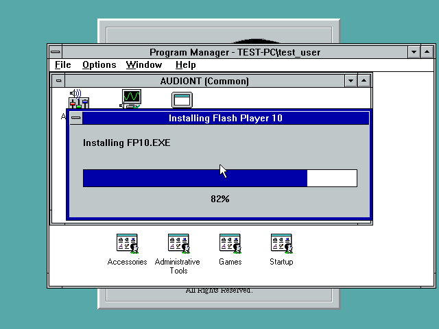
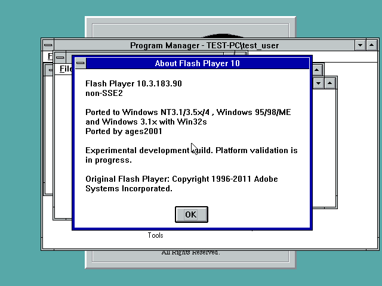
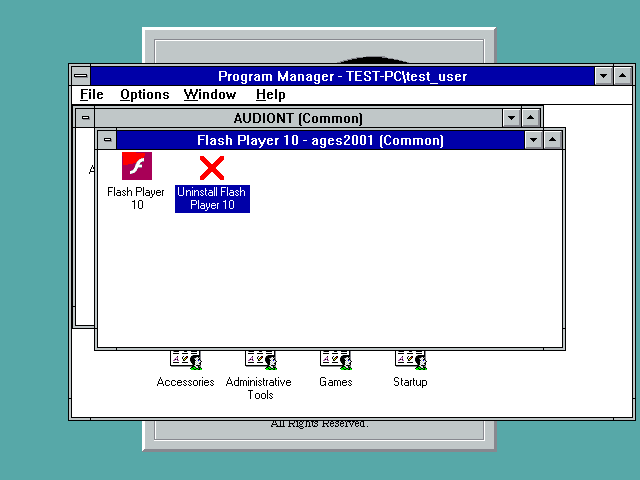

# FP10 automatic CPU mode — NT3.1 development installer R2

[Download the complete installer, runtime and source ZIP](FP10-AUTOCPU-20261102-R2-DEV.zip?raw=true)
or the [single-file NT3.1 setup](SETUP10-AUTOCPU-20261102-R2.EXE?raw=true).
**This is an unfinished development port, not universal OS support.**

R2 includes the extra FP10CPU.DLL dependency required by the automatic-mode
player. The builder validates required files before changing existing setup
output. The executable and runtime DLLs are identical to the tested R1 runtime.

Native NT3.1 testing on a Pentium II without SSE/SSE2 verified Next/Back, a
custom destination, progress and completion. All 15 installed payloads match
the runtime by native size and CRC32. The installed CPU-mode probe passed 14
checks; the registration/shortcut probe passed 11; the uninstall probe passed
25, all with zero failures. Native SWF association launch opened the vector
fixture. The two shortcuts and red-cross uninstall icon were observed.
Uninstall restored the old association byte for byte, preserved unrelated files
and deleted its own executable after Windows restart.

The default destination is `C:\FP10`. Choose an empty folder without spaces;
its parent must exist. Setup remains **NT3.1-only**. SSE2 mode requires the
separate query-aware XMM research guard on NT3.1; setup does not install it.
The current native installer test used non-SSE2 mode. Earlier R1 SSE2 runtime
results are separate evidence. No full game/media, GPU or other-OS pass is claimed.
The VGA dark-red/pink palette issue and Program Manager space limitation remain.

See [source and native results](installer-20261102/README.md).

ZIP: 7,066,851 bytes. SHA-256:
`6919e4384448b2ed0c6d4e8641f1904df6f342992141c316ceb0adc6167a12ae`

Setup SHA-256:
`9f322efa332e8f57029f176943ca1e2a89f14c34d35f88ae7050cdd9bbd5c88c`

# R1 manual runtime checkpoint

[Download the complete runtime/source ZIP](FP10-AUTOCPU-20261102-DEV.zip).

One original FP10 executable now selects usable SSE2 or non-SSE2 at startup.
Its About label and feature-reporting adapter agree with that selection.
NT 3.1 tests passed in three configurations (14 checks each): no SSE2 hardware,
SSE2 without the XMM guard, and SSE2 with the query-aware guard. Moving AS2
vectors and a 440 Hz PCM fixture tone were observed in both selected modes.
The same executable SHA-256 was used throughout.

The ZIP includes runtime DLLs, sources, fixtures, reports and screenshots.
Read its `README.TXT` before use. This is a manual development runtime, not a
new installer or completed multi-OS port. Win9x/Win32s playback, every SIMD/JIT
path, GPU acceleration, video codec coverage and actual SM63 save/reopen are
not certified. Existing installer and FP32 release archives are unchanged.
The separate research XMM driver retains its documented limitations.

See [native results](reports/fp10-dynamic-native.json),
[emulator results](reports/fp10-dynamic-emulation.json),
[non-SSE2 About](screenshots/861-fp10-nonse-about.png), and
[SSE2 About](screenshots/867-fp10-sse2-about.png).
