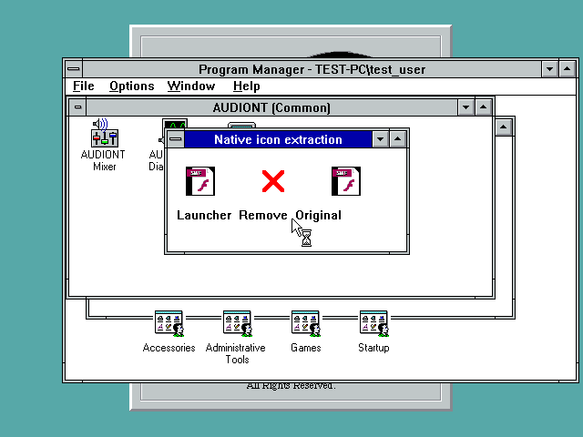
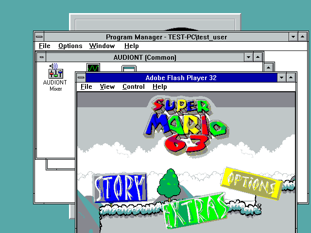
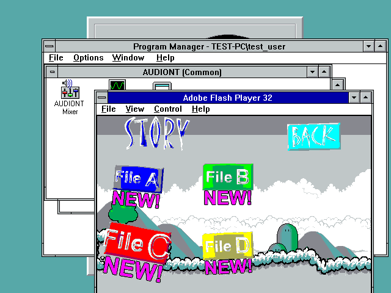

# R2 public download and native follow-up checks

Both public raw-GitHub downloads were fetched again after commit 3e28123.
The ZIP SHA-256 is 461477a38b9f5242b52088bd0391d594590742bb6295faa4f8cfcf3510d3b367;
the installer SHA-256 is 5d3f788ea9a4ab2fdfabd7337cbcfb7d909ded059f858df84f7be2f91e17dc3a.
Both match the local build. Every CRC in the public ZIP passes.

The final original-icon launcher was deployed into the existing NT31 staging
directory. Native extraction shows identical launcher and original engine
icons. No-file startup opens the original native window and menu bar.
Launching the supplied MARIO.SWF reaches the title; native clicks pass through
Start, Story, and the save-slot selection. Transitions are visibly delayed.
One earlier menu click reached Extras; returning and clicking the settled
Story button reached save-slot selection. This is not an all-input pass.

File A still displays NEW after the restart. Save persistence is not certified;
the earlier session may not have reached a save checkpoint. Available physical
memory at this scene was 10,919,936 bytes out of 66,519,040. These are functional
observations, not an acceptable-performance claim or complete game test.

