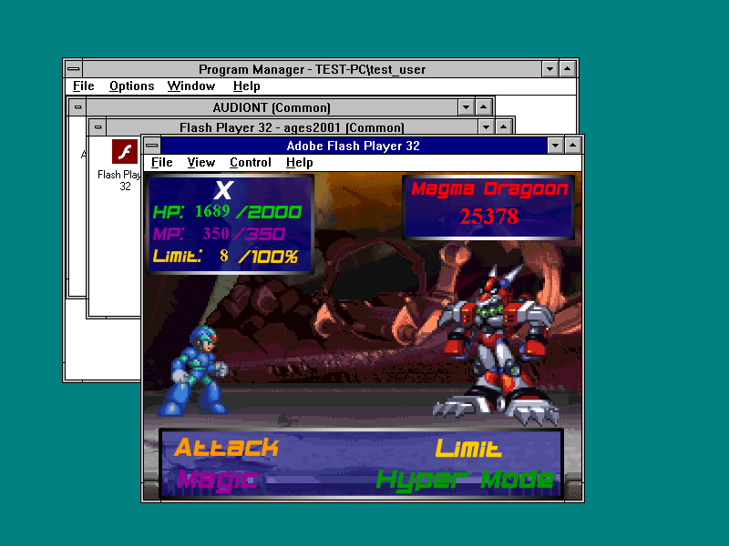
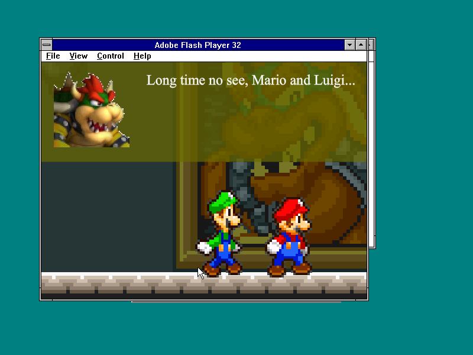
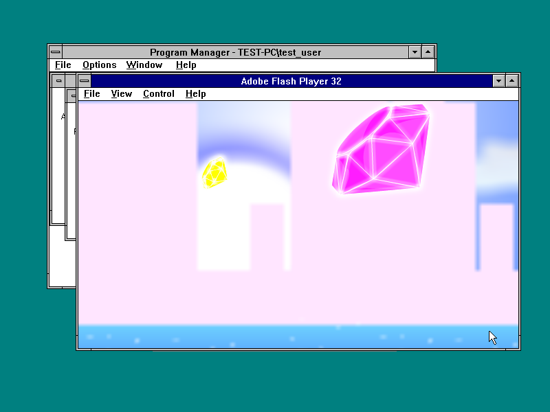

# R3 follow-up observations

The published R3 ZIP and installer are immutable. Both public downloads were
retrieved successfully and their byte counts and SHA-256 values matched; see
[r3-public-downloads.json](r3-public-downloads.json).

Additional tests used original Adobe FP32 in the NT 3.1 QEMU guest, with
WINVBE 800x600x32 and AC97. These are limited observations, not full-game passes.

| Game | Observed result |
| --- | --- |
| Final Fantasy Sonic X6 | Menu, Play input and prologue animation/dialogue. A six-second AC97 session capture was non-silent. |
| MMS RPG 1 | Title Play reached dialogue; Space advanced Mario to Bowser dialogue. |
| Sonic RPG 10 v1.3.6 | The 284,501,034-byte SWF loaded and Play started the animated intro. |
| Mega Man X Virus Mission | Go to Battle and one Attack turn completed: enemy HP 26000 to 25378, player HP 2000 to 1689, Limit 0 to 8%. |
| Takeover | R3 exits on a null dynamic InternetOpenA call after a cached WinINet load failure. A separate candidate fix is under test. |

[Machine-readable observations](r3-game-followup.json) and
[audio measurement](ffsx6-session-audio.json). Exact menu/prologue audio
segments were not isolated; synchronization and full sound coverage are unverified.

SM63 remains blocked by the unexpected Star Coin overlay after Start.
Full playthroughs, all game saves, performance certification, GPU acceleration
and the other requested operating-system runtimes remain incomplete.

