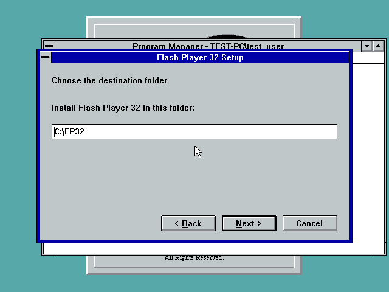
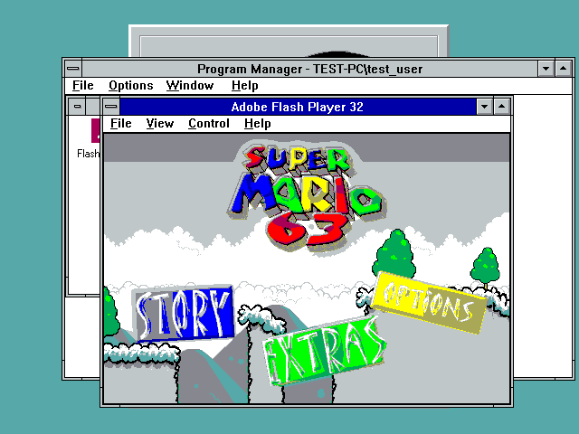
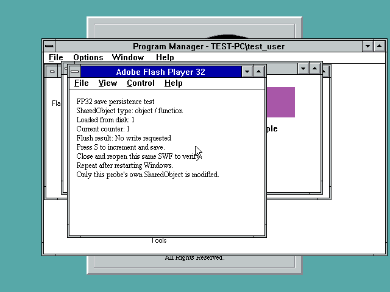

# FP32 legacy-port development checkpoint

[Download the complete R4 ZIP](FP32DEV-20261101-R4.zip?raw=true), including
source and the required XMM-query research driver. The
[NT 3.1 development installer](SETUP32-20261101-R4.EXE?raw=true) is also available.
**This is not a completed cross-platform port.** The original Adobe FP32 engine
remains in use. Games and guest OS disks are not bundled.

R4 fixes the false SM63 Star Coin overlay by reporting SSE/SSE2 together with
actual OS context readiness. The newly installed four-CPU NT 3.1 build reaches
the normal menu after Start and file selection after Story. The separate UP
gameplay experiment reached the fourth tutorial area with coins, jumping and
hover-FLUDD; that session used the diagnostic CPU-feature DLL, not a full
R4 installer test. Real SM63 progress save/reopen and adequate speed remain
unverified. Observed UP gameplay was roughly 3-8 FPS.

The installer defaults to `C:\FP32` and supports a custom folder. Its wizard,
progress and installation were checked on the MP copy. It is **NT 3.1 only**
and currently requires a destination without spaces for Program Manager icons.
Next/Back, uninstall and save-retention evidence from R3 remains historical;
R4 does not claim a new complete uninstall/reinstall pass.

## Required XMM prerequisite

Use a disposable supported NT 3.1 test VM. Copy `WINSIMD-QUERY/XMMGUARD.SYS`
and `LOADXMM.EXE` from the ZIP into `C:\FP32`, then run `LOADXMM.EXE` and
check `C:\FP32\GUARD.LOG`. The old public WINSIMD R2 guard does not implement
this readiness query. A running guard cannot be replaced without rebooting.
The player installer does not install this prerequisite automatically.

The query-bearing driver passed four native protocol checks on UP and MP.
On four CPUs, four workers completed 181 affinity rounds with no XMM/MXCSR/x87
mismatches; 640 worker lifetimes also completed with zero failures. Exact-kernel
checks, the 512-entry table and the unresolved installation-rendezvous limit
remain. This is research code, not a universal or production SIMD driver.

## Validation and remaining work

- The installed MP player passes the non-finite shape-hit-test fixture.
- An AS2 SharedObject fixture wrote counter 1 and loaded it after both player
  restart and Windows reboot. This is not a full SM63 save pass. Private
  UserData storage does not require an OS AppData directory.
- The startup gate stops when context readiness is absent and recommends
  Flash Player 10. The WinINet retry guard passes 4,096 emulated contracts;
  full Takeover gameplay/network behavior is not certified.
- Native 4bpp GDI dark red appears pink in both QEMU VGA models tested. The
  independent native color probe reproduces it outside Flash. The icon source
  is unchanged; final VGA color validation remains open.
- Another 123 required imports remain unimplemented. Full Win9x, Win32s,
  NT3.5x/NT4 integration, Win32s threading, universal installation, full game,
  menu and media coverage, GPU acceleration and YMM/ZMM preservation are open.

See [R4 changes](R4-CHANGELOG.txt), [status](STATUS.json),
[SM63 evidence](SM63-CPU-FEATURE-NOTES.md),
[XMM query tests](query-driver-native-status.json),
[installer evidence](r4-installer-path-candidate.json),
[MP save test](mp-query-save-fixture.json) and [save storage](SAVED-GAMES.md).
Back up the entire UserData tree, including its name maps.

ZIP: 43,621,446 bytes, 684 payload files.
All ZIP CRCs and payload SHA-256 hashes were verified.
SHA-256: `641fd1765c48e09ce90b70b7c5151d8c3bbd325e3102104783b50483fa90b224`

Installer SHA-256: `107efab3e1e8d296b6f1a722b9188a5250b2e42540e6ad4276e963be603cda3a`

[Historical R3 notes](R3-README.md), [R3 ZIP](FP32DEV-20261101-R3.zip?raw=true)
and [R3 follow-up](R3-FOLLOWUP.md) remain available unchanged. Separate packages:
[WINSIMD R2 research checkpoint](../winsimd-1.2-dev/README.md) and
[NT 3.1 MP patch r2 with source](../ntcpupae-2026-10-30/NTCPUPAE-NT31-FIX-r2.zip?raw=true).
