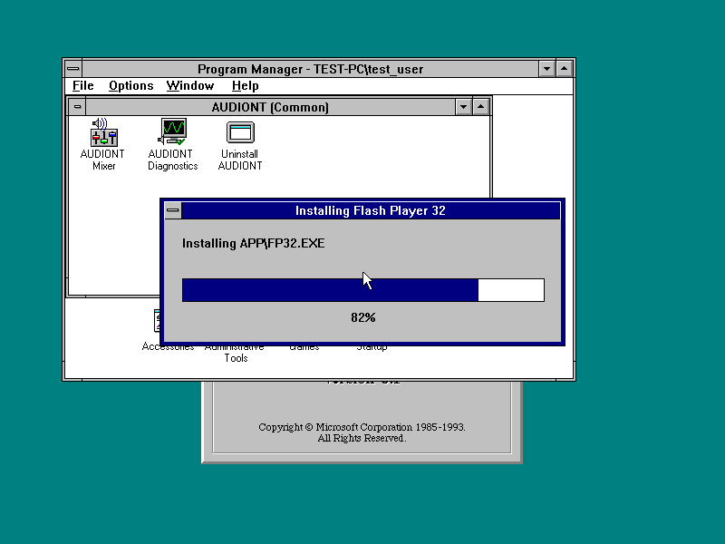
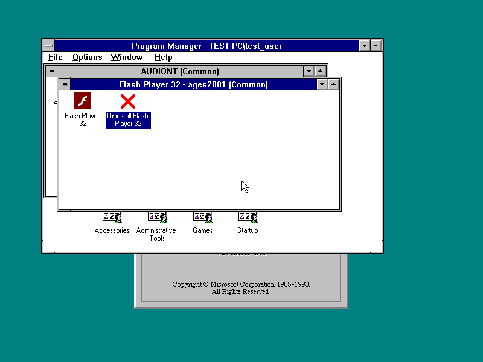
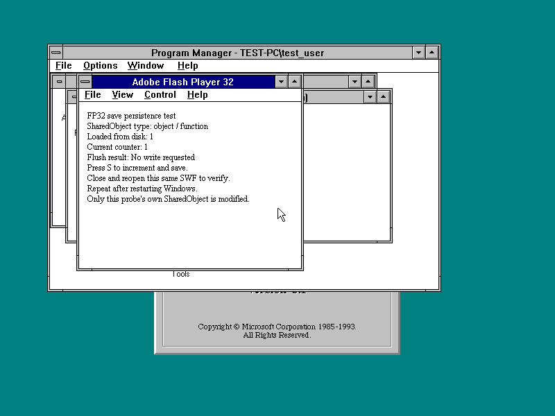

# FP32 legacy-port development checkpoint

[Download the complete R3 ZIP](FP32DEV-20261101-R3.zip?raw=true) or the
[single-file NT 3.1 development installer](SETUP32-20261101-R3.EXE?raw=true).

**This is not a completed cross-platform port.** Original Adobe FP32 remains
the engine. The package contains compatibility source, original build inputs,
native probes, test evidence and the earlier FP10 checkpoint. Games and guest
OS disks are not bundled.

R3 fixes legacy save storage without assuming an OS AppData folder, real BSTR
allocation, drive-root launcher startup, routine diagnostic overhead and the
application icon. The original dark-red application logo is selected; legacy
16-color fallbacks accompany the unchanged high-color frames. The uninstaller
uses a red cross. See [changes](R3-CHANGELOG.txt) and [icon details](ORIGINAL-ICON.md).

The R3 installer was freshly installed, removed and reinstalled on NT 3.1.
Next/Back/Finish, destination selection, progress, both native Program Manager
shortcut launches and native SWF association opening were verified. All 37
private save files retained identical paths, sizes and CRC32 values after
uninstall; original FP32 read counter 1 after Windows restart/reinstallation.
See [installer evidence](r3-installer-validation.json) and
[save evidence](r3-save-uninstall.json). Back up the **entire UserData tree**,
including name maps; see [saved-game storage](SAVED-GAMES.md).

The installer supports NT 3.1 only, defaults to C:\FP10, and currently requires
a destination without spaces for native Program Manager icons. SSE2 and a
separately loaded compatible XMM research driver are prerequisites.

SM63 still produces an unexpected Star Coin overlay after Start in the current
lab. **Full gameplay and acceptable performance have not passed.** Earlier
first-level observations do not override this current regression. See
[the blocker report](SM63-CURRENT-BLOCKER.md). Another 123 required imported
functions still stop diagnostic execution when reached; they are not success
stubs. The experimental HeapWalk implementation failed large-allocation tests
and is excluded.

Full Win9x/Win32s/NT3.5x/NT4 runtime integration, Win32s threading, universal
installation, complete menu/media/game coverage and final per-OS VGA tests are
unfinished. GPU acceleration and YMM/ZMM preservation are not validated.
Additional requested games are available as test inputs but are not certified
playable; see [game sources](GAME-INPUTS.md). See [STATUS.json](STATUS.json).

ZIP: 37,117,460 bytes; 488 payload files. Every
ZIP CRC and payload SHA-256 was verified. SHA-256:
`331ba481c071a9294d3f1e24f680fcb545d37401995fe211e40d17c1f3158728`

Installer: 18,199,184 bytes. SHA-256:
`38ca32a01ca5ea93ac6881b65f5fc3cf018550e4a70896d738b318253a78a3ca`

[Historical R2 ZIP](FP32DEV-20261101-R2.zip?raw=true) and
[R2 verification](R2-FOLLOWUP.md) remain unchanged. Separate packages:
[WINSIMD research checkpoint](../winsimd-1.2-dev/README.md) and
[NTCPUPAE patcher fix](../ntcpupae-2026-10-30/README.md).
