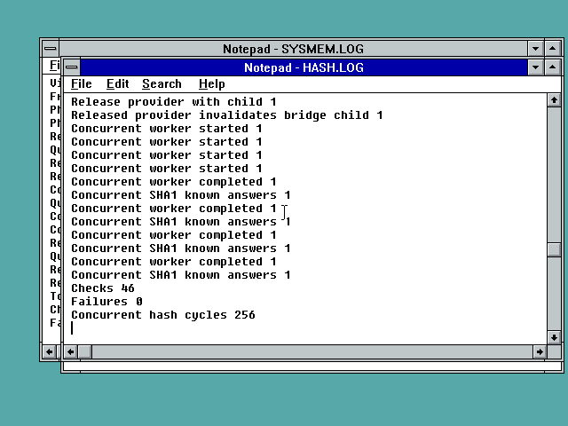

# FP32 unkeyed hash APIs using the original NT4 CSP

Five previously aborting FP32 imports now route to the supplied NT4 RSA base
provider: CryptCreateHash, CryptHashData, CryptGetHashParam, CryptSetHashParam
and CryptDestroyHash. The adapter tracks each public hash handle and its
provider, serializes access, rejects invalid handles without dereferencing them,
and destroys native child hashes before releasing their provider. Provider
errors are retained. Rejected release flags preserve existing children.

**Development diagnostic-import counts: FP10 61, FP32 111. Neither port is
complete.** CryptCreateHash currently supports unkeyed hashes only. Known-answer
tests cover MD5 and SHA1; the old provider rejects SHA256. Keyed hashes,
persistent key stores, encryption/signature/certificate compatibility and
full modern CryptoAPI behavior remain unfinished. The gap report now includes
explicit, non-exhaustive notes on partially implemented adapters so these
limits are not confused with the count of remaining aborting entries.

## Native results

The exact final C32A.DLL (a test alias of F32A.DLL) passes **46 hash checks on
NT3.1 and 46 on NT3.51**, zero failures. Tests include RFC MD5 abc, empty SHA1,
256 concurrent SHA1 abc computations across four workers, chunked input,
parameter and output-size queries, short buffers and guards, explicit digest
setting, finalized hashes, invalid/destroyed handles, rejected flags and
provider/child ownership. The existing RNG regression also passes **17 checks
per OS**, including 524,288 generated bytes across four workers and distinct
sample comparisons. RNG logs print counters in hexadecimal: 00000011 means 17.
These are functional tests, not a cryptographic security audit or a new RNG.

REA/Ghidra inspection of the original CPCreateHash and CPReleaseContext call
paths identified separately allocated CSP hash handles. The bridge explicitly
calls CPDestroyHash before CPReleaseContext; merely dropping bridge records
after context release would leave native child cleanup unaccounted for.
The final native runs use this corrected lifetime implementation.

**21 modeled-provider checks** execute the linked x86 DLL in Unicorn. The CSP
model rejects releasing a provider with live children, so the earlier cleanup
ordering cannot pass. Tests also cover separate providers, allocation/creation
failure, child-destruction failure, provider-release failure and successful
cleanup retries, including preserved errors and callee-saved registers/stack.
These tests validate bridge ownership; native known-answer runs validate the
actual legacy provider's hash results.

The supplied provider's executable sections remain byte-identical to the
original NT4 RSABASE.DLL. Existing changes are import redirection, loader
headers and PE padding. Hash algorithms are not rewritten. Source/adapted
hashes, final DLL fingerprints and REA evidence are included. Rebuilding the
kernel proxy changed only its timestamp/checksum relative to the separately
tested system-memory DLL; all sections are identical, as recorded in the
rebuild identity report. This is not a new full-player gameplay test.

## Use and limitations

These are component probes, not a new installer. Published FP10 R2 and FP32 R4
downloads are unchanged. Place the five test binaries in C:\FP32 on a
disposable native test guest, run HASHTEST.EXE and CRYPRNG.EXE, then read the
complete HASH.LOG and CRYPTO.LOG. Wait for final Checks/Failures lines; process
creation alone is not completion. Tests use NT3.1 and NT3.51 UP with classic VGA.
No Win9x/Win32s, GPU or all-game result follows from this component milestone.

`source` is an overlay for the cumulative development tree, after previous
shared-adapter/system-memory follow-ups, not a standalone distribution. Rebuild
with fp32/analysis/build_nt31.py and analysis/build_crypto_hash_tests.py. The
existing adapted CSP must be available; fp32/analysis/build_csp_probe.py records
its required original input hash. Run analysis/test_crypto_hash_ownership.py
for the host model check and analysis/audit_player_gaps.py for exact import
counts. SHA256.json lists every included file.

