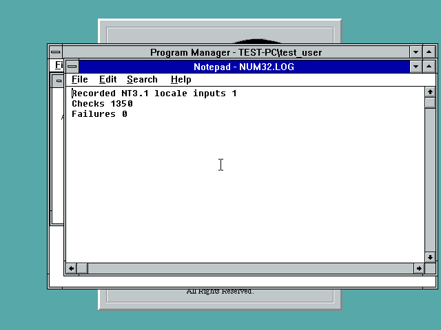

# Number/currency formatting and FP10 Winsock events

`GetNumberFormatW` and `GetCurrencyFormatW` now have decimal-string NT3.1
implementations in both players. No floating-point conversion loses long
integer digits. Rounding, zero suppression, negative styles, grouping,
Unicode symbols, buffer sizes and invalid arguments are covered. Available
native implementations are used where compatible; multi-size grouping on
old NT uses the adapter because the original NT3.51 API rejects it.

FP10 also uses the previously tested native manual-reset event adapters for
`WSACreateEvent` and `WSACloseEvent`. This does not implement `WSAEventSelect`,
network I/O or any still-missing Winsock APIs.

Current diagnostic import gaps: **FP10 49 / FP32 85**. These counts exclude
partial behaviors, dynamic APIs and untested OS compatibility. Neither port
is complete, and no universal installer is published by this checkpoint.

## Native validation

- Each actual player kernel DLL passed **1,350 comparisons per OS** on
  NT3.1 and NT3.51. The original NT3.51 functions generate the reference
  outputs; the NT3.1 run reads that binary reference. Custom en-US/de-DE/tr-TR
  formats are compared directly. For defaults, `NLSSPEC.BIN` records native
  NT3.1 NLS values and supplies those identical values to the NT3.51 oracle.
  Native locale data differs between releases and is deliberately preserved.
- Each kernel DLL passed **25 additional contracts on NT3.1 / 19 on NT3.51**:
  modern repeating/stopping grouping, exact 30-digit rounding, Unicode currency,
  short/null buffers, and invalid input. NT3.1 additionally tests a temporary
  `iNegNumber` override, NOUSEROVERRIDE and restoration of the prior value.
- FP10 Winsock event support passed **19 checks per OS**: independent events,
  initial state, manual-reset persistence, wait-all, reset, duplicate handles,
  close and the Winsock invalid-handle error slot.
- All final reports have zero failures. Alias DLLs in `TestBinaries` are byte
  identical to the published component files; `result.json` records hashes.

The first reference runs caught empty-number handling, separator validation
and differing native locale data. The first NT3.51 contract runs stopped at
a null-input call; the adapter now validates arguments before native dispatch,
and both final contract tests complete. The precise old-provider exception
mechanism was not established. Failed/incomplete first reports are retained
and clearly named; they are not passing evidence.

NT3.1 has no native `LOCALE_INEGNUMBER` query. The fallback uses measured
negative-number defaults from the supplied English NT3.51 locale set and an
explicit current-user registry override when present. Unknown defaults are
rejected, not guessed. This is not certification of every localized NT image,
Win9x, Win32s, or arbitrary custom NLS installations. NT3.1 and NT3.51 also
lack an exported `NtQueueApcThread`; QueueUserAPC remains unresolved.

## Files and scope

`components` contains only the three changed functional DLLs. Preserve each
player's other runtime files and UserData tree; do not copy these DLLs into
Windows system directories. The combined R2 runtime ZIP includes both complete
runtime directories and these updates. Existing published installers are
unchanged. The exact remaining imports are in `reports/player-gap-audit.json`.

The previous SM63 save/reopen/Windows-reboot evidence uses the earlier 87/53
runtime. **SM63 was not replayed with these latest three DLLs.** Comparison of
all 44 runtime files in `format-runtime-equivalence.json` shows that only FP10
FPK/FPW and FP32 F32K have functional changes; all other differences are PE
timestamps/checksums. That comparison is not a substitute for a new gameplay
pass. Classic VGA color errors, low frame rate, other games, full media/UI
coverage, other OS integration and GPU acceleration remain unresolved.

To reproduce the native tests, copy TestBinaries to C:\FP32 in a disposable
NT3.1/NT3.51 guest and run NUM10/NUM32, FMTC10/FMTC32 and EVENTS10. Run one
reference test at a time on NT3.51 because it rewrites FMTBASE.BIN; never
replace the NT3.1 reference with results using different NLSSPEC inputs.
Sources include the original-provider comparison, native locale capture and
contract tests. The full prepared build environment/reference inputs are
required for rebuilding the players.
