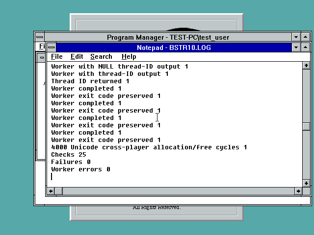

# Shared FP10/FP32 adapters: native component results

Current linked development builds contain **61 FP10** and **117 FP32**
unimplemented imported DLL/API pairs (previous development counts: 65 and 118).
`reports/player-gap-audit.json` identifies every pair and the audited DLL hashes.
These counts cover explicit diagnostic stubs reached by original static/delay
imports. They exclude partially implemented behavior and missing dynamic APIs;
even zero stubs would not establish a complete port. Published FP10 R2 and FP32
R4 installers are unchanged (their corresponding counts remain 65 and 123).

## Changes

- FP10 now shares the tested native NT OpenThread and SetThreadAffinityMask
  adapters with FP32. The existing FP32 CreateThread NULL-ID compatibility fix
  is shared with FP10: NT3.1's original function dereferences that optional
  output pointer. The shared wrapper provides a temporary when it is NULL.
- FP10 SysFreeString ordinal 6 shares FP32's allocator policy. Native OLEAUT32
  is preferred as an allocation/free pair; without Automation, both DLLs use
  the documented BSTR byte-length prefix and the process heap.
- Both players implement SHGetDiskFreeSpaceExW using the native legacy NT
  64-bit filesystem-size query. Later Windows' native quota-aware function
  is preferred when available. No Win9x fallback is provided by this change.

## Native QEMU checks

| Test | NT3.1 UP | NT3.51 UP |
| --- | --- | --- |
| FP10 disk-space export | 24 passed | 24 passed |
| FP32 disk-space export | 24 passed | 24 passed |
| FP10 thread handles/affinity with FP32 process-mask reference | 27 passed | 27 passed |
| Cross-player BSTR ownership and optional thread-ID output | 25 passed | 25 passed |

All eight final native runs completed with zero failures. BSTR tests allocate
through the actual FP32 DLL and free through FP10's ordinal export. Native
commit rises by 1,052,672 bytes for a one-MiB string and returns to its prior
value after release on both systems. Four workers perform 4,000 Unicode
allocation/free cycles; two start with a NULL thread-ID output. Tests verify
completion and exit status. A preliminary probe incorrectly used a modern
RtlValidateHeap signature and native CreateThread(NULL ID); those failed runs
are not counted as passes. The final probe uses native process commit queries
and the actual corrected FP10 thread export.

Disk tests cover directory and file paths, errors, optional outputs, current
directory, and an actual 64-KiB allocation/deletion. Independent Unicorn runs
execute the linked x86 exports with modeled native providers: **56 cases per
DLL, zero failures**, including >4-GiB sizes, >32-bit allocation-unit counts,
quota-aware forwarding, failed queries, output guards and stack/register
preservation. Modeled-provider tests do not establish native large-volume or
modern-Windows coverage. REA/Ghidra analysis of the original NT3.1 kernel DLL
corroborates the filesystem query layout; pseudocode is not original source.

NT3.1 uses QEMU TCG, one Pentium III with SSE2 exposed, 512 MiB and classic VGA;
NT3.51 uses one Pentium II, 64 MiB and classic VGA. These are component tests,
not a new full-player gameplay, SSE/XMM safety, multiprocessor, Win9x or Win32s
pass. Existing SM63 save evidence belongs to its separately fingerprinted
gameplay build. Remaining multimedia, shell, networking, crypto, timer and
other compatibility work is explicitly retained in the gap report.

## Contents and reproduction

`source` is a cumulative-development-tree overlay, not a standalone source
distribution. Preserve its directory layout: the FP32 shared-source includes
require the top-level `compat` files. Rebuild FP10 with compat/build_trace.py
and analysis/build_fp10_dynamic_cpu.py, then FP32 with fp32/analysis/build_nt31.py
using the existing toolchain and original input files. Run
analysis/build_shared_tests.py and analysis/audit_player_gaps.py next.

`test-binaries` contains exact component DLLs under isolated test aliases and
the native probes. Use C:\FP32 on a disposable test guest. BSTR12.EXE is the
final BSTR10 source build under an unused filename to avoid overwriting an
earlier crashed process's locked image. It writes BSTR10.LOG; DSK10/DSK32 and
AFF10 write their matching LOG files. Read complete Checks/Failures lines;
process creation alone is not test completion. These files are not an installer.

