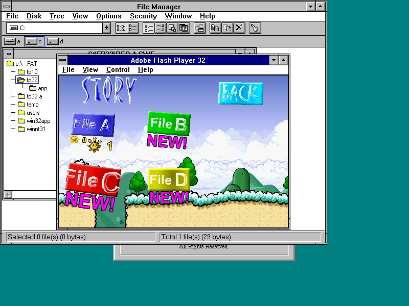
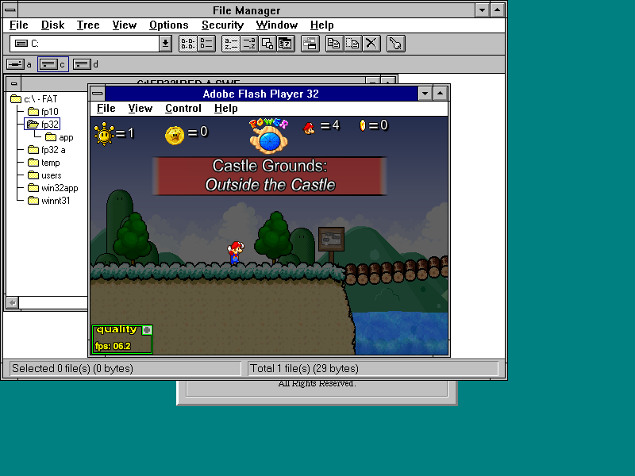

# Actual SM63 first save and player reopen

The untouched user-supplied Super Mario 63 game saved its first Shine and loaded
that progress after closing and restarting the original Adobe FP32 engine on
the NT3.1 UP gameplay candidate. This is an actual game test, not the earlier
synthetic serialization fixture.

Physical play crossed the tutorial exit pipe, entered the castle, used the
Sling Star to reach the upper floor, and delivered the Shine to Eddie in the
Orb room. The original returnstar animation sets Star[39] and calls SaveFile.
The later Save prompt was also clicked and dismissed successfully.

| Native SOL read | Bytes | FileAStar[39] | FileExists |
| --- | ---: | --- | --- |
| Before entering the pipe | 5478 | false | absent |
| After delivering the first Shine | 5730 | true | true |
| After clicking Save | 5730 | true | true |
| After reopening and loading File A | 5730 | true | true |

All three post-save files have SHA-256
`e0196be29bc0a2f365eba522008c6290cbdd616929ca5c387d129cd590efd240`.
The player window disappeared after closing engine PID 60. The launcher then
started a new engine, PID 81 (the launcher's own PID was 51). The new game
displayed one Shine in File A and loaded **Castle Grounds: Outside of the Castle**
with one Shine. No VM snapshot was restored to establish this persistence.

The SOL files were read through the guest's native file API and decoded on the
host without editing them. Full before/after files, decoded values, native
process logs, screenshots, read-only tools and runtime hashes are included.
The SWF SHA-256 matched the original upload:
`6f8dc22d74963cb75928fcac6ad67769384c3088bb419f9995e24b81d8411e1c`.

## Scope

- QEMU TCG, Pentium III + SSE2, one CPU, 512 MiB, standard VGA 800x600 4bpp,
  AC97 and an existing research XMM guard.
- Separate diagnostic CPU-reporting gameplay candidate; exact executable and
  DLL hashes are in `reports/sm63-game-runtime-fingerprint.json`.
- The current component-development DLLs and the query-aware R4 installer were
  not substituted during this test. The R4 downloads are unchanged.
- This verifies the first real save and **player restart**. Actual-game Windows
  reboot persistence, other accounts, other OSes, every save slot and complete
  gameplay remain unverified. The earlier fixture reboot pass is separate.
- Observed gameplay is still roughly 3-8 FPS. No satisfactory performance,
  complete sound/video correctness or GPU acceleration claim is made.

Back up the entire UserData tree, including its mapping files. Individual SOL
files here are evidence, not an installable save backup or a player package.
No OS disks, migration RAM, or complete SWF are distributed in this evidence.
