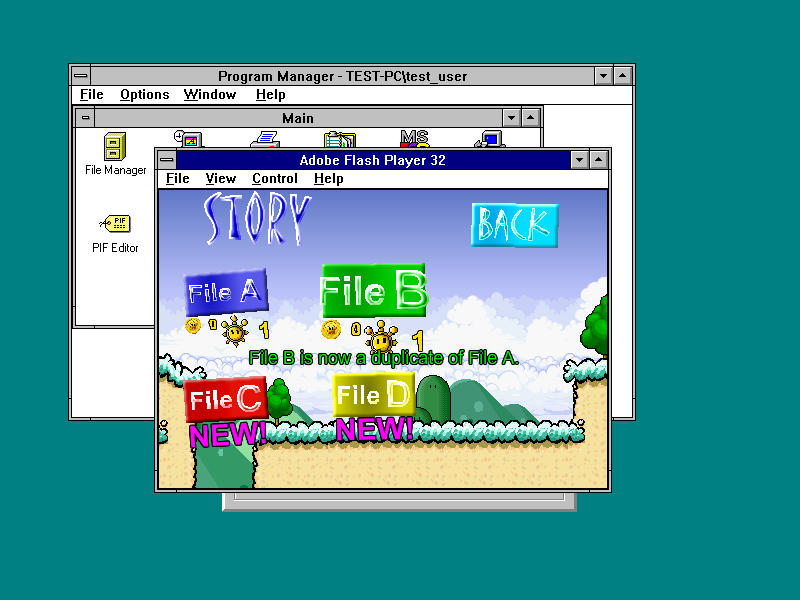
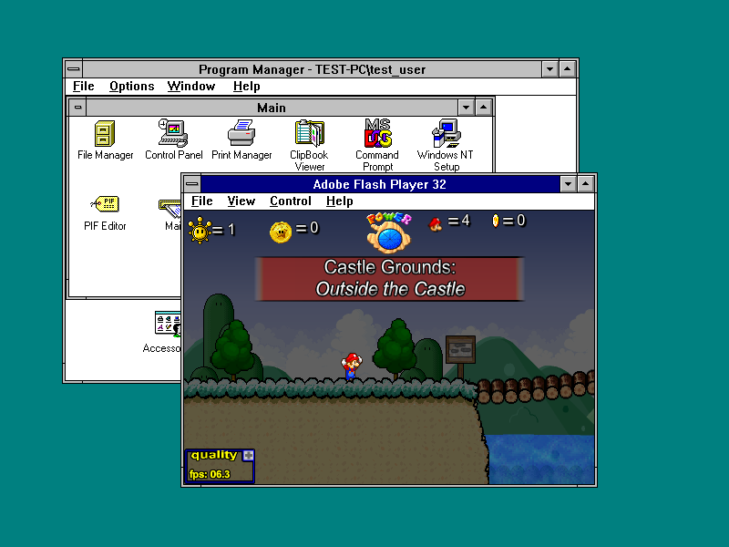
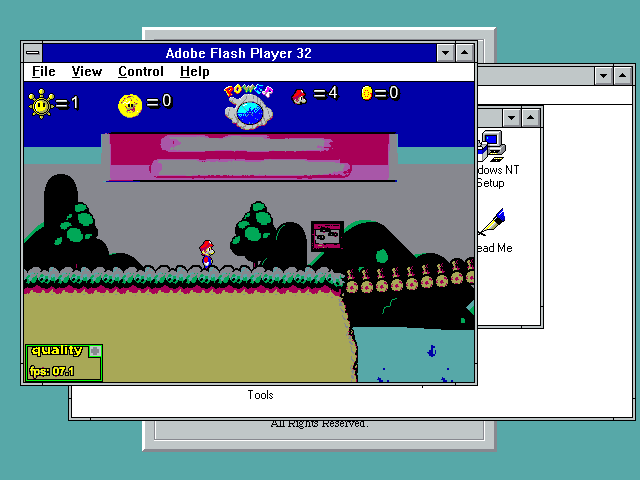

# SM63 regression with the accumulated FP32 components

The current FP32 runtime loads the original SM63, opens saved File A at Castle
Grounds with one Shine, accepts physical movement/jump and pause/exit input,
copies File A into File B through the game's own menu, and loads File B after
both a new player process and a normal Windows restart. All tests run on
separate QCOW2 overlays; the original saved-game disks are unchanged.
This is a bounded regression, **not a complete port or all-game pass**.

## Save evidence

`save-before.sol` has File A's first Shine and an empty File B. After the game's
Copy confirmation, `save-after-copy.sol` preserves all File A fields and makes
all File B fields equal File A, including Star 39. The independent AMF0 reader
records both states in `save-copy-decoded.json`. The 5,730 bytes after Copy,
player reopen and OS reboot match SHA-256
`4f45ad24ed6aaf89f5c6b879550a2f00ace9203043fc28db673de4af1e979c5b`.
No game variables, SWF or SOL contents were edited by the test. No VM migration
snapshot was used as evidence of persistence. The native path is under
`D:\UserData`, not an OS AppData folder. Preserve the installation root and
all UserData/name maps when updating: launching a copy under `C:\FP32`
selects a different private save tree and does not test the D-root save.

## Native runtime and display checks

`modules-d-root.txt` and `modules-vga.txt` are read-only PEB/LDR inspections
of the actual engine. Their checked module paths and native file CRCs match
nine current loaded proxies, including F32K/F32M/F32G, in the two accompanying
JSON files. `deployed.json` records the full deployed set. The original adapted
engine is SHA-256 `2f09f7eecabc16e56cfa9c1f6c5ba06b63cce8d0c9cda1591b41c7a5bf02a136`.
The latest mixer binaries differ from the native component checkpoint only
in PE timestamp/checksum bytes, as documented by the equivalence report.

The initial game session uses **WINVBE 800x600x32**. QEMU's standard VGA
hardware device alone does not identify the guest display driver. Native
GDI/registry queries bypassing F32G establish the actual driver and bit depth.
An earlier save report's unmeasured claim of 800x600 4bpp VGA is withdrawn;
that does not change its save results. The `/basevideo` switch alone did not
select VGA here. On the disposable overlay, the existing Vga Start value was
kept at 1 and winvbe Start changed from 1 to 4, with original values and
readback logged. After a native Windows reboot and normal boot, the native
probe reports **Vga, 640x480, 4bpp, 16 colors**. The same File B loads again.
The native XMM query passes four checks after the restart.

Classic VGA visibly reduces/distorts colors and is sluggish. Adequate color
fidelity and performance are not certified. Initial WINVBE software gameplay
was around 6 FPS. The original game's selection uses frame-polled hover;
Move, a two-second settling interval, then Click avoids selecting the old
hovered slot in this test. This is a test procedure, not a fix to input lag.

`gameplay-audio.wav` is a one-second nonzero stereo AC97 PCM excerpt from the
D-root SM63 session (AUDIONT 1.1). It does not establish every soundtrack,
effect, Runouw logo timing, video decode path or A/V synchronization. The
preceding final-second sample during pause was silent and was not counted
as playback. Other games, FP10 gameplay in this session, other OSes, GPU
acceleration, all menus, universal installation and the 87/53 remaining
FP32/FP10 diagnostic API gaps remain open.
