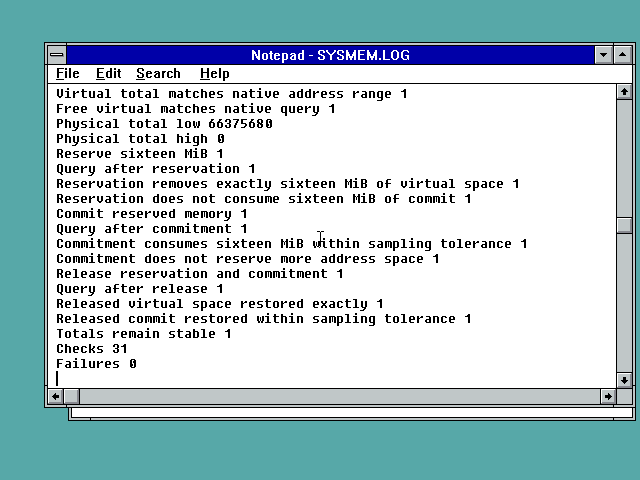

# FP32 system memory: native NT3.1/3.51 component results

GlobalMemoryStatusEx now queries native legacy NT system and process counters.
The adapter preserves full-width physical/commit byte totals, reports process
virtual space and available commitment, and uses the modern percentage-based
memory-load metric. It prefers the native Windows export if present. Invalid
structures, unavailable providers and failed native queries return errors and
leave the output unchanged. This replaces a diagnostic abort in FP32; FP10
does not import this API.

**Current development counts: FP10 61, FP32 116** unimplemented imported
DLL/API pairs. The full port remains incomplete. See the accompanying exact
gap list and DLL hashes. Published FP10 R2 and FP32 R4 installers are unchanged.

## Evidence

The exact linked G32K.DLL (a test alias of F32K.DLL) passed **31 checks on NT3.1
and 31 on NT3.51, zero failures**. The probe compares native memory/address
information and guards the output structure. Reserving 16 MiB removes exactly
that amount of free virtual space without consuming its full commit charge;
committing the reservation then consumes the expected commitment. Releasing
it restores virtual space exactly and commitment within the documented one-MiB
sampling tolerance for independent system activity.

The separate native structure probe records the exact legacy query lengths:
44-byte system basic information, 312-byte performance information, 32-byte
process quotas and 44-byte process VM counters. REA/Ghidra analysis of the
original NT3.1 GlobalMemoryStatus corroborates the query classes and offsets.
Its decompiled stack-variable expressions are imperfect; instruction-level
inspection and native results were used to interpret them. In particular,
the old function's DWORD products are not reused for 64-bit totals.

**24 Unicorn cases also pass**, executing the linked x86 export with modeled
providers. Explicit fixtures cover 8-GiB physical / 12-GiB commit totals,
finite and exhausted process quotas, physical/virtual exhaustion, all four
native-query failures and length mismatches, invalid data, output atomicity,
callee-saved registers/stack and preference for a native modern export.

These last cases are model tests, not native >4-GiB, finite-quota or modern-OS
validation. The native NT3.1 component VM is configured with 512 MiB in QEMU
but its existing legacy boot setup exposes approximately 64 MiB: the observed
physical total is 66,650,112 bytes. NT3.51 reports 66,375,680 bytes on its 64-MiB
VM. This is separate from the earlier SM63 gameplay VM using the supplied
loaders. No 512-MiB visibility or new gameplay claim is made by this test.
Win9x/Win32s and complete FP32 multimedia/runtime support remain unfinished.

## Files and reproduction

`source` is an overlay for the cumulative development tree, after the shared
adapter and earlier memory/GUID/thread follow-ups. It is not a standalone source
distribution. Rebuild with fp32/analysis/build_nt31.py, then
analysis/build_system_memory_tests.py; the latter copies the actual F32K.DLL
to isolated G32K.DLL. Deploy G32K.DLL and SYSMEM.EXE to C:\FP32 in a disposable
guest, run the probe and read the complete SYSMEM.LOG. SYSMNAT.EXE optionally
records raw native counters in SYSMNAT.LOG. Host model verification uses
analysis/test_system_memory_width.py with pefile and Unicorn installed.

The accompanying component DLL is not a new full-player installer. All hashes
are in SHA256.json. The cumulative current gap audit is refreshed by
analysis/audit_player_gaps.py, rather than manually decrementing a counter.

